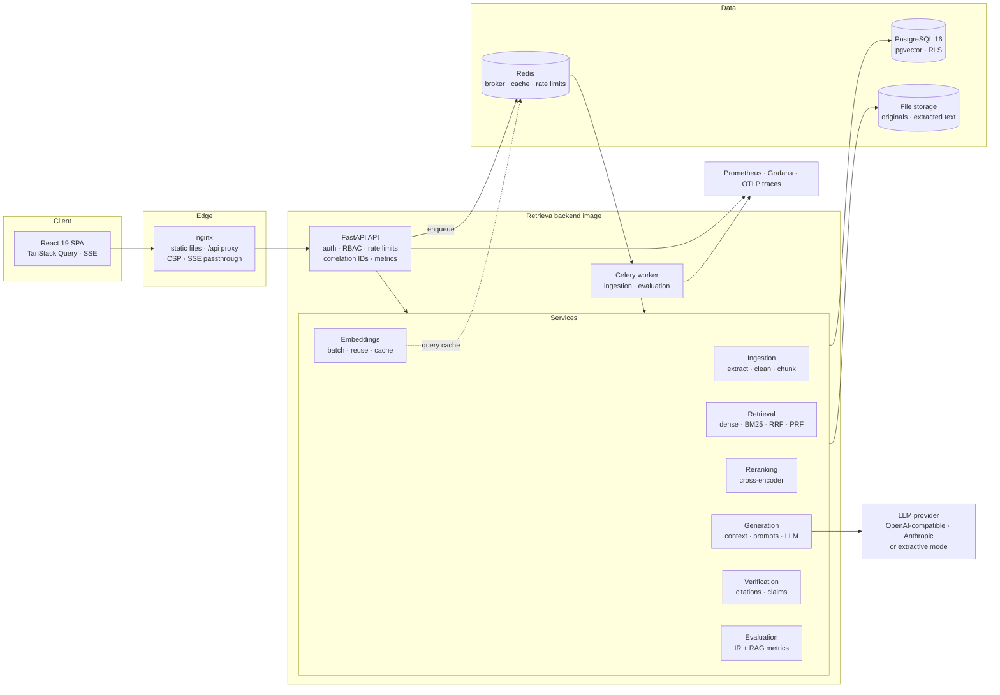
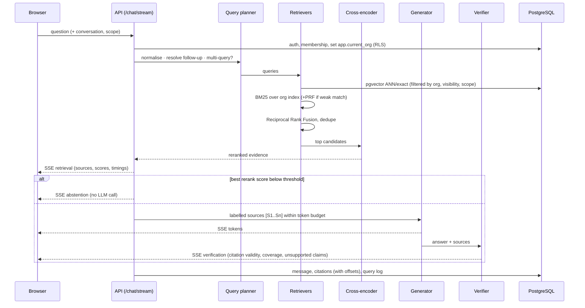
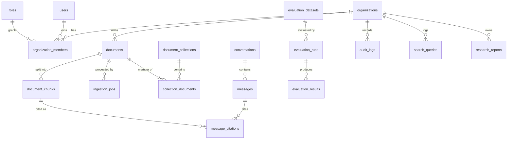

# Retrieva Architecture

Retrieva is a **modular monolith**: one FastAPI application and one Celery worker image share a
single Python package with strict internal service boundaries. Each boundary (ingestion,
embeddings, retrieval, reranking, generation, citations, evaluation) talks to the others through
plain interfaces, so any of them can be extracted into its own service later without rewriting
callers.

## System overview

## Request flow: answering a question

## Key design decisions

### Multi-tenancy in two layers
Every tenant-owned row carries `organization_id`.

1. **Application layer.** All queries filter by the caller's organization, and by document /
   collection visibility (`private` items are visible only to their owner and admins).
2. **Database layer.** PostgreSQL Row-Level Security with `FORCE ROW LEVEL SECURITY` on every
   tenant table. Policies compare `organization_id` with `current_setting('app.current_org')`,
   which the API sets per transaction (`SELECT set_config(..., true)`), re-applied on every new
   transaction by a SQLAlchemy `after_begin` hook. The API connects as `retrieva_app`, a role
   with neither `SUPERUSER` nor `BYPASSRLS`; migrations run as the owner. A test
   (`test_row_level_security_blocks_cross_tenant_reads_at_database_level`) connects as the app
   role with **no** application filters and shows that other tenants' rows are invisible and
   cross-tenant inserts are rejected.

Permission filtering always happens **inside retrieval**, before evidence is returned —
never after generation.

### Retrieval engine
| Stage | Implementation | Why |
| --- | --- | --- |
| Dense | pgvector cosine (or inner product), HNSW index (m=16, ef_construction=64) | Semantic matching. Small tenants and explicitly scoped searches use an exact scan, because HNSW post-filtering in a shared multi-tenant index can return too few rows; large tenants use HNSW with `ef_search=200` and fall back to exact if filtering starves the result set. |
| Sparse | Okapi BM25 (k1 = 1.2, b = 0.75) implemented in-house over a shared analyzer (Snowball stemming, identifiers kept) | Exact terminology (`AES-256`, clause numbers). Per-organization in-memory index, invalidated by a (count, max created_at) version stamp. |
| Fusion | Reciprocal Rank Fusion, k = 60, per-retriever weights | Rank-based: fuses cosine and BM25 without score normalisation. |
| Query techniques | Follow-up rewriting (LLM or heuristic), multi-query, RM3-style pseudo-relevance feedback, metadata boost for documents named in the query | Each is gated: rewriting only for follow-ups, PRF only when the normalised BM25 match strength is weak *and* the corpus is large enough, multi-query only for compound questions. Every decision is recorded. |
| Reranking | `cross-encoder/ms-marco-MiniLM-L-6-v2` (lexical fallback) | Joint query–passage scoring; also drives the abstention gate. |
| Post-processing | Near-duplicate removal (shingle Jaccard), optional contextual compression | Avoids wasting context on repeated boilerplate. |

**Contextual chunk headers.** Each chunk is embedded and BM25-indexed together with its document
title and heading path ("Master Services Agreement > 6 Termination"), so a passage that never
names its subject can still be found by a query that does.

### Ingestion
Extract (format-specific, preserving pages, headings and tables) → clean (Unicode
normalisation, de-hyphenation, running header/footer removal) → chunk (recursive, token,
semantic or structure-aware; every chunk keeps exact character offsets into the extracted text,
page range and heading path) → embed (batched, retried, dimension-validated, **reusing vectors
for unchanged content**) → index. Each stage commits its status, so the UI shows live progress;
stage durations are stored per job.

### Evidence-grounded generation and verification
* Sources are passed as `<source id="S1" ...>` envelopes; source text cannot close the envelope,
  instruction-like content is detected and reported, and the system prompt treats sources as
  untrusted data.
* The model must cite every factual sentence or reply `INSUFFICIENT_EVIDENCE`.
* An **independent verifier** runs after generation: claim extraction, citation-to-chunk
  mapping, fabricated-label detection, support scoring (lexical precision + best-sentence
  embedding similarity, or an NLI cross-encoder when configured), number checks (every figure in
  a claim must appear in a cited source), page-reference checks, and aggregate citation
  validity / precision / evidence coverage.
* **Extractive mode** (no LLM) composes answers from verbatim evidence sentences — useful
  offline and as a hallucination-free baseline.
* Scores are reported per stage on their own scale (cosine, BM25, RRF, cross-encoder logit,
  verifier support); nothing is presented as "confidence".

### Authentication
Argon2id password hashing; 15-minute JWT access tokens kept in memory by the SPA; opaque
14-day refresh tokens stored hashed, delivered in an `httpOnly`, `SameSite=Strict` cookie scoped
to `/api/v1/auth`, and rotated on every use. Replaying a rotated token whose successor has
already been used revokes the whole token family (theft detection); a rotated token whose
successor was never used is recognised as a lost response or concurrent tab and safely
re-issued. Membership and role are re-read on every request, so role changes and removals take
effect immediately.

### Asynchronous work
Uploads return immediately; processing runs in Celery (`ingestion` and `evaluation` queues,
`acks_late`, prefetch 1). Without a broker, `INGESTION_MODE=thread` runs jobs in an in-process
pool (development) and `inline` runs them in the request (tests).

### Observability
* JSON logs with correlation IDs (`X-Correlation-ID` is accepted, generated, and returned).
* Prometheus metrics: HTTP rate/latency per route, retrieval stage latency, embedding and LLM
  latency, LLM tokens, ingestion outcomes, cache hit rates, abstentions. Multi-process
  aggregation for uvicorn workers and Celery pools.
* OpenTelemetry tracing for FastAPI, exported over OTLP (Jaeger in the monitoring profile).
* Grafana dashboard and Prometheus alert rules in `infrastructure/monitoring`.

## Data model

All schema changes are Alembic migrations (`backend/alembic/versions`). The vector dimension is
a deployment setting (`EMBEDDING_DIM`); changing to a model with a different dimension requires a
new migration and re-embedding (`/documents/{id}/reprocess`). Vectors are stored with their model
version, and retrieval only compares vectors of the active model.

## Scaling notes and known limits
* **BM25 index** lives in each API/worker process memory and is rebuilt per organization when its
  chunk set changes. This is correct and fast up to roughly 10⁵ chunks per organization; beyond
  that, swap the `SparseIndexCache` for a database-native BM25 (ParadeDB `pg_search`) or
  OpenSearch behind the same `sparse_search` interface. IDF statistics are computed across the
  organization's chunks, including private documents (only aggregate term counts, never text).
* **HNSW with tenant filters** (pgvector 0.6/0.7) post-filters candidates; the exact-scan
  threshold mitigates this. pgvector ≥ 0.8 iterative scans or per-tenant partial indexes are the
  next step for very large multi-tenant deployments.
* **Model inference** runs on CPU in-process. For higher throughput, move embeddings and
  reranking behind a model server (e.g. text-embeddings-inference) — the provider interfaces are
  already isolated.
